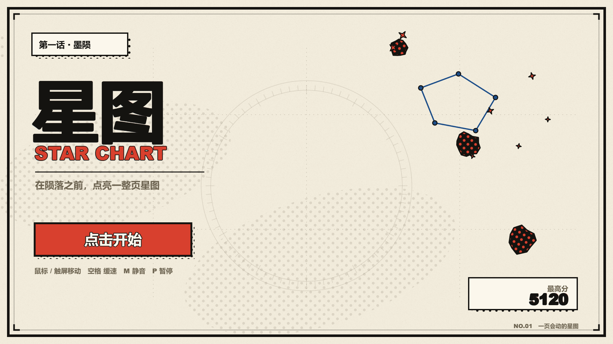
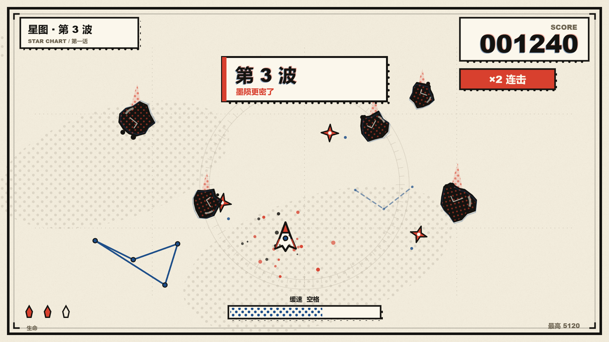

# 星图 STAR CHART

一页会动的漫画星图。你是一枚彗星，在印刷网点与纸纹之间穿行：躲开砸落的**墨陨**，收集**星点**，集满七颗就连出一条星座——整页被冲击波清空。

**在线试玩：** https://hong-ry.github.io/star-chart/





## 玩法

| 操作 | 键盘 / 鼠标 | 触屏 |
|---|---|---|
| 移动 | 鼠标移动，或 方向键 / WASD | 手指拖动 |
| 缓速 | 按住 **空格**（或鼠标右键） | 长按屏幕 |
| 暂停 | **P** | — |
| 静音 | **M** | — |
| 重开 | **R** | — |

- 每收集一颗星 **+10 × 连击倍率**；2.2 秒内连续收集不断连击，每 3 连 +1 倍率（上限 ×5）。
- 集满 **7 颗星** 完成一条星座：连线留在纸面上，冲击波清空全屏墨陨，**+100**。
- 缓速能把时间压到 0.35×，能量 3 秒耗尽、松开回充；能量见底会短暂过热。
- 3 条命；被撞损失 1 条、1.5 秒无敌、连击清零。
- 每 22 秒进入下一波，墨陨更密更快。
- 最高分存在浏览器 localStorage。

## 设计

这套视觉不是「深空霓虹」，而是**印刷波普**：米白纸面、墨黑描边、印刷红与印刷蓝，加上本戴网点、错版印刷的蓝影、纸纹和漫画页框。所有画面由代码绘制，没有任何图片素材。

- 色板（6 键）：`#F2ECDC` 纸 / `#FBF7EC` 面 / `#141310` 墨 / `#6E6552` 次 / `#D8402E` 红 / `#1D4E89` 蓝
- 禁用：渐变底、霓虹光、蓝紫大面积（AI 片子里最常见的偷懒配色）
- 动效：飞船弹簧跟随、收集弹跳、撞击屏震 140ms + 停帧 70ms、波次横幅 expoOut 300ms
- 画面里永远有东西在动：飘移的网点云、星点脉动、彗尾、陨石尾焰

视觉规范参考了开源技能 [huashu-art-motion](https://github.com/alchaincyf/huashu-art-motion)（花叔·艺术动画）的风格配方与色板规则；迭代评审参考 [darwin-skill](https://github.com/alchaincyf/darwin-skill) 的「独立盲评 + 棘轮」方法。

## 技术

- 纯原生 Canvas 2D + ES5 风格 IIFE，**零依赖、零构建**，双击 `index.html` 就能跑。
- 1920×1080 逻辑坐标，按窗口等比缩放居中；支持高 DPI。
- 静态网点/纸纹预烘焙成 CanvasPattern，逐帧只做绘制调用（实测 160+ fps，无掉帧）。
- 音效全部由 WebAudio 实时合成（三角波/方波/噪声 + 滤波），没有音频文件。

```
index.html
css/app.css
js/core.js     调色板、网点、墨线、漫画字、面板
js/audio.js    WebAudio 音效合成
js/game.js     状态机、实体、碰撞、渲染、输入
tools/shot.mjs 无头浏览器截图（开发用）
docs/          截图
```

### 本地运行

```bash
python -m http.server 8123
# 打开 http://127.0.0.1:8123
```

## License

MIT
