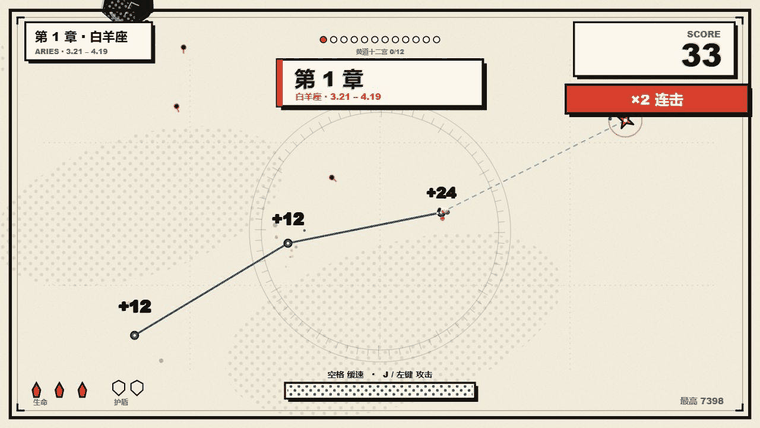
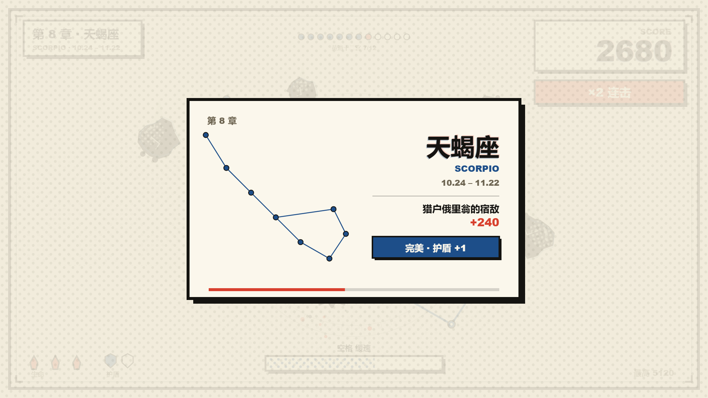
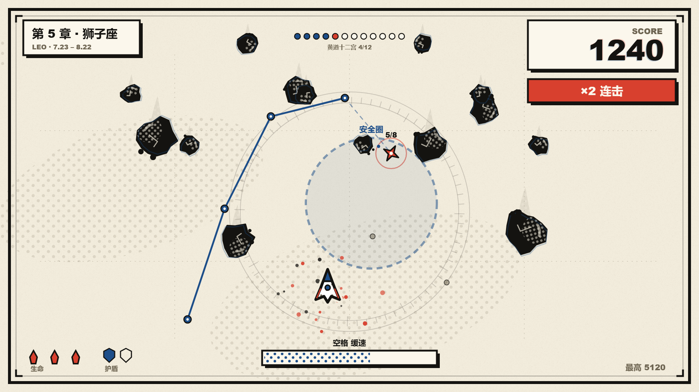
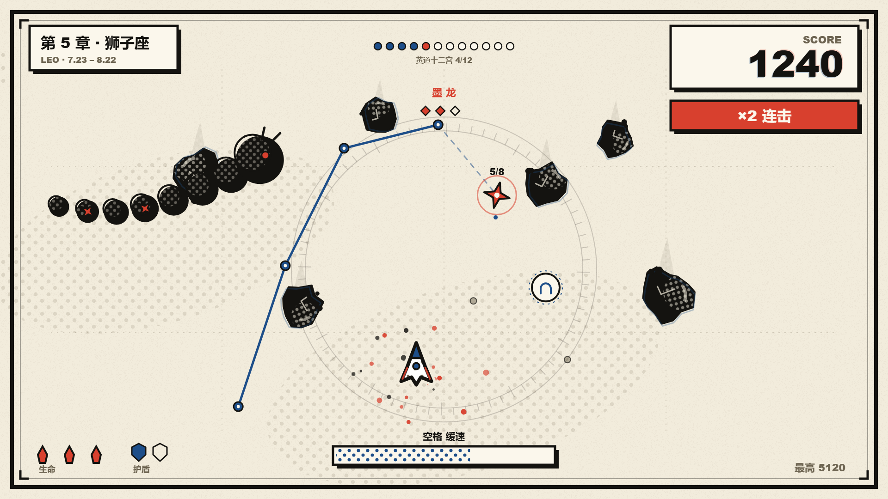
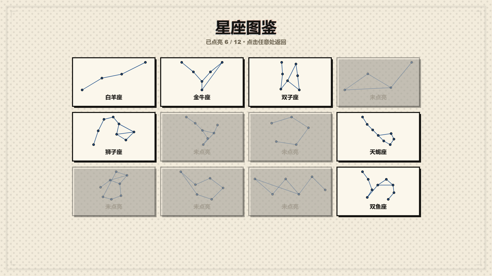

# 星图 STAR CHART

一页会动的漫画星图。你是一枚彗星，在印刷网点与纸纹之间穿行，**按顺序点亮黄道十二宫**，躲开砸落的墨陨、墨潮与墨龙，把整页星图连完。

**在线试玩：** https://hong-ry.github.io/star-chart/





## 玩法

每一章对应一个星座，星点按真实星座形状摆位：

1. 只有**下一颗**星会亮（红色脉冲环 + `4/6` 计数），其余是灰色暗星；虚线指向它；
2. 按顺序飞过去点亮，星点依次连线画出星座；
3. 集满一宫 → **星座卡**：星图、中英文名、日期、神话一句、加分；
4. 全程没被撞到算「完美」：额外 +120 并得 **1 个护盾**（最多 2 个，挡一次撞击）；
5. 集齐 12 宫 → 「十二星座集齐」终局；也可以直接进**无尽模式**。

### 三类事件

| 事件 | 出现时机 | 玩法 |
|---|---|---|
| **道具** | 每完成一个星座掉落 | 磁吸（8s，下一颗星被吸过来）/ 时停（3s，墨陨静止）/ 穿透（5s，无视碰撞） |
| **墨潮** | 第 4、8、12 章 | 5 秒密集陨石雨，蓝色「安全圈」会把落入的墨陨溶解；撑过去 +150 |
| **墨龙** | 第 6、12 章 | 墨色长龙横穿页面，靠近并点亮它身上的 3 个赤色弱点，退散后 +200 并获得护盾 |





### 无尽模式

通关 12 宫后可进入无尽：星座循环、每轮难度继续加，计分不断累计，直到命用完。



### 图鉴

点亮的星座会永久记在本地图鉴里（标题页按 **G** 打开），没点亮的显示为灰卡。

## 操作

| 操作 | 键盘 / 鼠标 | 触屏 |
|---|---|---|
| 移动 | 鼠标移动，或 方向键 / WASD | 手指拖动 |
| 缓速 | 按住 **空格**（或鼠标右键） | 双指按住 |
| 跳过星座卡 | 点击屏幕 | 点击 |
| 图鉴 | **G**（标题页） | — |
| 暂停 / 静音 / 重开 | **P** / **M** / **R** | — |

规则补充：点亮一颗星 +12 × 连击倍率（2.2 秒内不断连，每 3 连 +1，最高 ×5）；护盾挡一次撞击；3 条命用完本局结束；章节越往后墨陨越密越快（无尽模式有难度上限）。

## 设计

视觉是**印刷波普**：米白纸面、墨黑描边、印刷红与印刷蓝、本戴网点、错版蓝影、纸纹和漫画页框；全部由代码绘制，没有图片素材。

十二星座是手写简化的星图坐标（每宫 4–9 颗星，按连线顺序收集），不是随机撒点。

- 色板（6 键）：`#F2ECDC` 纸 / `#FBF7EC` 面 / `#141310` 墨 / `#6E6552` 次 / `#D8402E` 红 / `#1D4E89` 蓝
- 禁用：渐变底、霓虹光、蓝紫大面积
- 动效：飞船弹簧跟随、点亮弹跳、撞击屏震 + 停帧、星座卡 expoOut 弹入

视觉规范参考 [huashu-art-motion](https://github.com/alchaincyf/huashu-art-motion)；迭代评审参考 [darwin-skill](https://github.com/alchaincyf/darwin-skill) 的「独立盲评 + 棘轮」方法。

## 技术

- 纯原生 Canvas 2D + ES5 风格 IIFE，**零依赖、零构建**；
- 1920×1080 逻辑坐标，等比缩放居中，支持高 DPI；
- 网点/纸纹预烘焙成 CanvasPattern，160+ fps；
- 音效全部 WebAudio 实时合成；
- 进度（最高分、图鉴）存 localStorage。

```
index.html
css/app.css
js/core.js     调色板、网点、墨线、漫画字、面板
js/audio.js    WebAudio 音效合成
js/game.js     十二星座、事件、Boss、无尽、图鉴、渲染、输入
tools/shot.mjs 无头浏览器截图（开发用）
docs/          截图与演示
```

### 本地运行

```bash
python -m http.server 8123
# 打开 http://127.0.0.1:8123
```

## License

MIT
